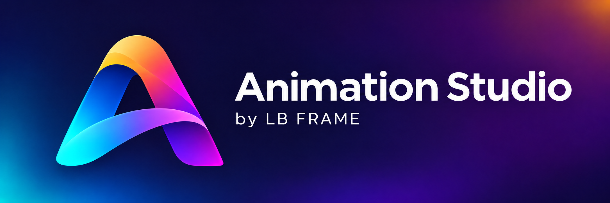
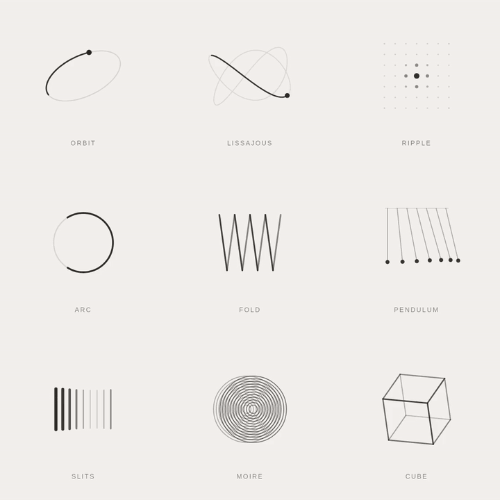
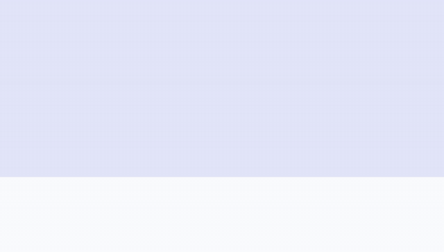
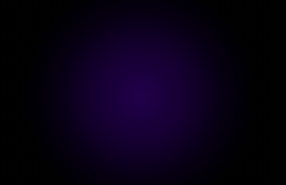
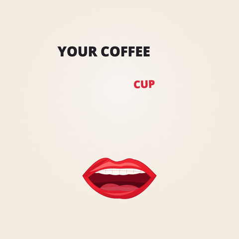
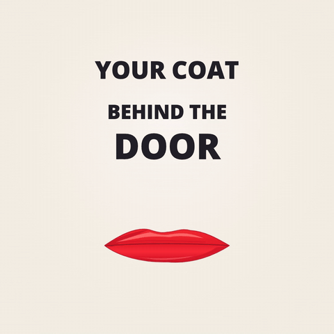

<p align="center">
  
</p>

<p align="center"><strong>Turn an idea or a reference into an animation you can use.</strong></p>

<p align="center">An Agent Skill for creating, rendering, reviewing, and refining motion.<br>Start with a description, an image, a video, or an accessible reference link.</p>

<p align="center"><a href="#quick-install">Quick install</a> · <a href="#showcase">Showcase</a> · <a href="#make-your-own">Make your own</a> · <a href="docs/workflow.md">Workflow</a></p>

## Quick install

Copy this prompt into Claude, Codex, or another agent that supports Agent Skills:

```text
Install the create-animation Agent Skill from:
https://github.com/lbframe/animation-studio

The skill is in skills/create-animation/.
Use the documented installation method for your current agent environment.
Review SKILL.md and install the complete skill folder with its resources.
Preserve existing skills and customizations; report conflicts before replacing files.

Verify the installation path, required files, relative references, and skill
discovery where supported. Identify any missing runtime dependencies.
Report what you installed, what you verified, and one example invocation.
If blocked, explain the exact blocker and the next action needed.
```

**Skill name:** `create-animation` · **Display name:** Animation Studio · [Installation guide](docs/installation.md)

## Showcase

The original loader study, followed by seven animations created with Animation Studio. Click an animation for its original MP4; open the example to see the original request in English and a refined prompt.

### Nine loaders in motion

<p align="center"><a href="https://github.com/lbframe/animation-studio/releases/download/v0.1.0/nine-loaders.mp4"></a></p>

**Nine procedural loaders** · 4-second loop · Canvas rendering · Silent

The study that informed Animation Studio: nine minimal geometric motifs, coordinated cycles, and editable motion. [Watch the full-resolution video](https://github.com/lbframe/animation-studio/releases/download/v0.1.0/nine-loaders.mp4) · [Explore the prompt](examples/nine-loaders/README.md)

### A whole hero, in motion

<a href="https://github.com/lbframe/animation-studio/releases/download/v0.1.0/kinetic-hero.mp4"></a>

**Klozeo hero** · 9 seconds · Canvas compositing from a supplied screenshot

A staged reveal follows the page's visual hierarchy and settles into the original composition. [Watch the full video](https://github.com/lbframe/animation-studio/releases/download/v0.1.0/kinetic-hero.mp4) · [Explore the prompt](examples/kinetic-hero/README.md)

<table>
<tr>
<td width="50%" valign="top">
<h3>Ribbon A</h3>
<a href="https://github.com/lbframe/animation-studio/releases/download/v0.1.0/ribbon-a.mp4"></a>
<p><strong>A logo reveal from one image.</strong><br>5 seconds · Canvas compositing</p>
<p><a href="https://github.com/lbframe/animation-studio/releases/download/v0.1.0/ribbon-a.mp4">Full video</a> · <a href="examples/ribbon-a/README.md">Prompt &amp; breakdown</a></p>
</td>
<td width="50%" valign="top">
<h3>Kinetic B</h3>
<a href="https://github.com/lbframe/animation-studio/releases/download/v0.1.0/kinetic-b.mp4"></a>
<p><strong>Letterforms and a mark, choreographed together.</strong><br>8 seconds · Canvas compositing</p>
<p><a href="https://github.com/lbframe/animation-studio/releases/download/v0.1.0/kinetic-b.mp4">Full video</a> · <a href="examples/kinetic-b/README.md">Prompt &amp; breakdown</a></p>
</td>
</tr>
<tr>
<td width="50%" valign="top">
<h3>Speaking mouth</h3>
<a href="https://github.com/lbframe/animation-studio/releases/download/v0.1.0/speaking-mouth.mp4"></a>
<p><strong>A character detail becomes a playful loop.</strong><br>6 seconds · Procedural Canvas · Silent</p>
<p><a href="https://github.com/lbframe/animation-studio/releases/download/v0.1.0/speaking-mouth.mp4">Full video</a> · <a href="examples/speaking-mouth/README.md">Prompt &amp; breakdown</a></p>
</td>
<td width="50%" valign="top">
<h3>Living garden</h3>
<a href="https://github.com/lbframe/animation-studio/releases/download/v0.1.0/garden-loop.mp4"></a>
<p><strong>Quiet motion inside a still illustration.</strong><br>5 seconds · Image compositing · Cinemagraph</p>
<p><a href="https://github.com/lbframe/animation-studio/releases/download/v0.1.0/garden-loop.mp4">Full video</a> · <a href="examples/garden-loop/README.md">Prompt &amp; breakdown</a></p>
</td>
</tr>
<tr>
<td width="50%" valign="top">
<h3>A chorus in type</h3>
<a href="https://github.com/lbframe/animation-studio/releases/download/v0.1.0/lyric-chorus.mp4"></a>
<p><strong>Lyrics, rhythm, and a recurring character.</strong><br>24.1 seconds · HyperFrames + GSAP · Audio</p>
<p><a href="https://github.com/lbframe/animation-studio/releases/download/v0.1.0/lyric-chorus.mp4">Watch with sound</a> · <a href="examples/lyric-chorus/README.md">Prompt &amp; breakdown</a></p>
</td>
<td width="50%" valign="top">
<h3>The full lyric film</h3>
<a href="https://github.com/lbframe/animation-studio/releases/download/v0.1.0/lyric-film.mp4"></a>
<p><strong>A complete song, through the closing credits.</strong><br>3 minutes 4.9 seconds · HyperFrames + GSAP · Audio</p>
<p><a href="https://github.com/lbframe/animation-studio/releases/download/v0.1.0/lyric-film.mp4">Watch with sound</a> · <a href="examples/lyric-film/README.md">Prompt &amp; breakdown</a></p>
</td>
</tr>
</table>

GIFs are lightweight, silent previews. The two lyric previews are excerpts; full videos preserve the supplied exports. Refined prompts are documented suggestions, distinct from the original requests that produced these renders. See [asset provenance](docs/assets/ASSETS.md).

## Make your own

Describe what you want to move, attach any reference, and name the output you need. A short request is enough to start; the skill fills in routine production choices.

```text
Use the create-animation skill to animate the attached logo.
Preserve its shape and colors. Build a confident, fluid reveal with a
readable final hold, and deliver an MP4 plus editable source.
Preview the result, check for visual defects, and refine it before delivery.
```

| Start with | What the skill does |
| --- | --- |
| A description | Turns the intent into a motion brief, composition, and timeline. |
| An image | Identifies the shapes, layers, and visual details to preserve, then proposes motion. |
| A video or link | Inspects accessible reference material, separates observed timing from estimates, and chooses a production route. |
| An existing animation | Reviews the result, diagnoses defects, and improves the relevant passages. |

You can specify duration, aspect ratio, looping, audio, transparency, delivery format, or an existing stack. The available tools and assets determine which production routes can actually be completed.

## How it works

1. **Understand the reference.** Preserve the subject, wording, visual hierarchy, and constraints.
2. **Choose the right tools.** Match the delivery to an available renderer, timeline, rig, or generator.
3. **Build and render.** Produce editable sources and an actual animation preview.
4. **Review and refine.** Inspect motion, pixels, timing, text, and the ending or loop seam.
5. **Deliver.** Package the result with its sources and a clear account of what was verified.

The workflow adapts to the job: logos, interfaces, kinetic typography, procedural scenes, or reference-driven motion. [Read the workflow](docs/workflow.md).

## Inside the skill

| Resource | Purpose |
| --- | --- |
| [SKILL.md](skills/create-animation/SKILL.md) | The production workflow and decision rules. |
| `references/` | Intake, backend choices, motion design, review criteria, and primary sources. |
| `assets/motion-brief.md` | A compact production brief template. |
| `scripts/inspect_reference.py` | Image/video metadata and timestamped inspection material. |
| `scripts/check_loop.mjs` | Numeric continuity checks for procedural loop state. |

Animation Studio is a workflow skill. Install the rendering tools needed for your project; the skill does not bundle every engine or a video generation service. See [dependencies and setup](docs/installation.md).

## Contributing

Useful contributions include clearer workflows, focused helper improvements, reproducible examples, and fixes supported by a real reference or rendered result. See [CONTRIBUTING.md](CONTRIBUTING.md).

## License

The skill and original project code are provided under the [MIT License](LICENSE). Showcase media, supplied references, fonts, music, and third-party components retain their respective rights; see [asset provenance](docs/assets/ASSETS.md).

<p align="center">Made by <strong>LB FRAME</strong>.</p>
