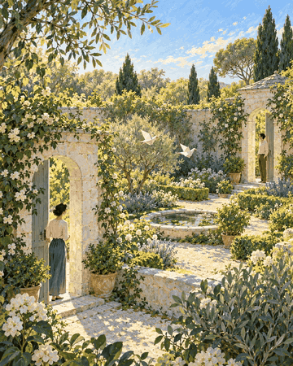

# Garden cinemagraph

[Back to the showcase](../../README.md#showcase) · [Watch the original video](https://github.com/lbframe/animation-studio/releases/download/v0.1.0/garden-loop.mp4)



A painted garden gains subtle motion in its foliage, paper birds, and pond while the figures and architecture remain stable.

## Showcase render

| Input | Output | Method |
| --- | --- | --- |
| Supplied garden illustration | 5-second loop · 1122 × 1402 · 30 fps · silent | Image compositing with Python, NumPy, and SciPy; FFmpeg video export |

Independent breezes move the foliage, the paper birds hover gently, and ripples animate the water. The motion is evaluated from time with a five-second period. The camera remains fixed, retaining the image's painted composition.

## Original request — English translation

> Use this reference image and animate it as a five-second loop.

No further correction was recorded for this example.

## Recommended prompt

Attach the garden image, then paste:

```text
Use $create-animation to create a seamless five-second ambient loop from
the attached garden illustration.

Preserve its painterly appearance, composition, figures, and architecture.
Add a gentle, varied breeze to the foliage, subtle hovering motion to the
paper birds, and restrained ripples in the pond. Keep the two people and
the camera stable, with no sound.

Make every animated region return smoothly through the loop boundary.
Avoid visible warping around faces, stone edges, and the protected figures.

Deliver editable source and an MP4 at the reference's original aspect
ratio, 1122 × 1402, 30 fps. Inspect the moving regions and loop transition
in the rendered result, then correct visible artifacts.
```

Five seconds and looping were explicit requirements. The particular moving regions and restrained ambient treatment are recommendations drawn from the delivered cinemagraph.

## Source and review notes

The original project contains `render.py`, pinned Python requirements, the reference image, a motion brief, and `QA.json`. The code exposes foliage regions, paper-bird motion, pond effects, and protected figure regions.

The source report records periodic-state and neighboring-frame checks, supported by rendered stills and chronological frame strips. Continuous playback was not certified in that report. The result animates the supplied image through compositing; the characters retain their original poses.

The showcased render was created before the recommended prompt was written. This adaptation has not been rerun to certify an identical result.
