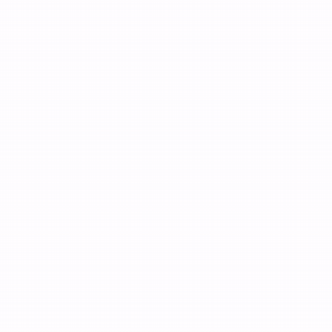

# B logo and kinetic type

[Back to the showcase](../../README.md#showcase) · [Watch the original video](https://github.com/lbframe/animation-studio/releases/download/v0.1.0/kinetic-b.mp4)



Folded color ribbons lead into a typographic sequence, with distinct movement for the bold title, lighter lettering, and small slogan.

## Showcase render

| Input | Output | Method |
| --- | --- | --- |
| Supplied logo and lettering image | 8 seconds · 740 × 740 · 30 fps · silent | Canvas compositing with an editable JavaScript timeline; FFmpeg video export |

The logo assembles first. **LOREM** rises into place, **IPSUM** converges through its letter spacing, and **AWESOME SLOGAN** follows in a smaller cascade. The sequence finishes on the original arrangement. Letter shapes and ribbon facets come from the reference image.

## Original request — English translation

> Using this reference image, can you animate the logo, then the text, in a kinetic typography motion design style?

No further correction was recorded for this example.

## Recommended prompt

Attach the complete logo and lettering reference, then paste:

```text
Use $create-animation to animate the attached logo and typography.

Create an eight-second sequence on the reference's white background.
Assemble and settle the colored ribbon logo first, then animate LOREM
IPSUM and AWESOME SLOGAN. Give the bold and light lettering distinct
motion: a controlled lift for the bold letters, converging spacing for
the light letters, and a quieter cascade for the slogan.

Preserve the exact wording, letter shapes, ribbon facets, colors, and
visual hierarchy. End with a readable hold on the original arrangement.
Keep the composition silent and the camera fixed.

Deliver editable source, a playable preview, and a 740 × 740 MP4 at
30 fps. Inspect letter clipping, overlaps, transitions, and the final hold.
```

The duration, motion treatments, and output settings make the original direction more specific using choices from this example. The original request established the logo-first, typography-second sequence.

## Source and review notes

The original project contains `motion.js`, `render.cjs`, `build-html.py`, a motion brief, and a standalone HTML preview. Its timeline, masks, and transforms are editable; the lettering remains derived from the supplied image.

The showcased render predates the recommended prompt. This adaptation has not been rerun to certify an identical result. The source package records a delivered study without a separate final user-approval record.
