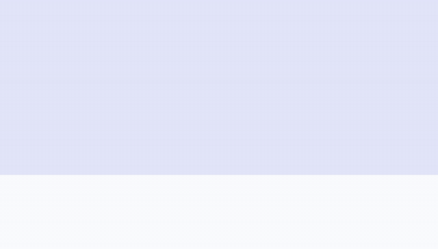

# Kinetic hero

[Back to the showcase](../../README.md#showcase) · [Watch the original video](https://github.com/lbframe/animation-studio/releases/download/v0.1.0/kinetic-hero.mp4)



A product hero unfolds through its navigation, logo, headline, supporting copy, and calls to action.

## Showcase render

| Input | Output | Method |
| --- | --- | --- |
| Supplied Klozeo desktop screenshot | 9 seconds · 1440 × 820 · 30 fps · silent | Canvas compositing with an editable JavaScript timeline; FFmpeg video export |

The motion follows the page's information hierarchy: the header and logo lead, the headline arrives in two stages, then the supporting copy, buttons, and secondary information appear. The ending returns to a stable view of the supplied design.

## Original request — English translation

> Can you animate the logo and all the hero text in a kinetic typography motion design style, and animate the navigation appearing?

The request included the hero screenshot. No further correction was recorded for this example.

## Recommended prompt

Attach the hero screenshot, then paste:

```text
Use $create-animation to turn the attached desktop hero screenshot into
a nine-second motion design sequence.

Animate the navigation appearing, the brand and hero logo, the headline,
supporting copy, calls to action, and secondary information. Build a
clear reading order with staggered entrances and distinct typography
motion. Keep the exact wording, line breaks, colors, layout, and logo
identity from the reference. Finish with a readable hold on the complete
composition. Keep the camera fixed and the animation silent.

Treat this as an animation of the supplied screenshot. Deliver editable
animation source, a playable preview, and a 1440 × 820 MP4 at 30 fps.
Inspect masks, letter crops, overlaps, and the final reference match.
```

The nine-second duration and output settings come from the delivered example. The original request specified the logo, hero typography, and navigation entrances.

## Source and review notes

The original project contains `motion.js`, `render.cjs`, `build-html.py`, a motion brief, and a standalone HTML preview. Its logo, lettering, and page elements are composited from the source screenshot. The deliverable is an animation preview with editable motion code; a responsive website implementation would be a separate deliverable.

The showcased render predates this recommended prompt. The adaptation has not been rerun to certify an identical result.
