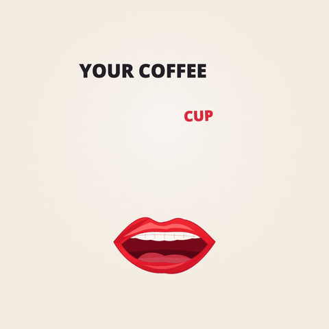

# Lyric chorus

[Back to the showcase](../../README.md#showcase) · [Watch the original video](https://github.com/lbframe/animation-studio/releases/download/v0.1.0/lyric-chorus.mp4)



Sung words emerge from an illustrated mouth and assemble into changing typographic compositions, with the current word highlighted.

## Showcase render

| Input | Output | Method |
| --- | --- | --- |
| Song audio, supplied lyrics, and mouth-pose reference | 24.1 seconds · 1080 × 1080 · 30 fps · audio | HyperFrames 0.9.17, GSAP, and Canvas |

The first chorus of **I Want the Mondays Too** was developed as a separate study before the full film. Its visual direction combines red illustrated lips, warm paper, black display typography, and red emphasis on the sung word.

## Original request — English translation

> Take this audio reference and use the lip-sync reference image from earlier. Make a music video that synchronizes the mouth with the lyrics, with the words coming out of the mouth in a karaoke-like kinetic typography motion design style. I suggest showing me the chorus first before doing the whole song. Make the video square, in a 1:1 format.

## Recorded follow-up — English translation

> Yes, I approve.

The source package identifies this response as approval of the first chorus study before extending the animation to the whole song.

## Recommended prompt

Attach the song, exact lyrics, and mouth-pose reference, then paste:

```text
Use $create-animation with the attached song, lyrics, and mouth-pose
reference. First create only the first chorus as a 1:1 video at
1080 × 1080, 30 fps, with the original audio excerpt.

Animate the illustrated mouth to the sung words. Let each word emerge
from the mouth, move into a readable lyric composition, and receive
emphasis while it is sung. Use red lips, a warm paper background, black
display typography, and red highlighting for the current word. Retire
each phrase cleanly as the next phrase starts.

Preserve the supplied lyrics exactly. Check word onsets against the
audio and give sustained vowels appropriate mouth holds. Keep timing
editable and report any synchronization that remains estimated.

Deliver the chorus video, editable project, and a playable preview.
Inspect lyric readability, phrase handoffs, and lip-sync. Show me this
chorus for approval before extending it to the complete song.
```

The square format, lip-sync, emitted lyrics, and chorus-first review were explicit requirements. The visual palette and output resolution make the prompt more specific using the delivered study's art direction. The excerpt duration follows the selected chorus rather than an arbitrary fixed length.

## Source and review notes

The original project includes the composition, mouth and scene code, word alignment, the audio excerpt, fonts with their license files, and HyperFrames render settings.

The source report distinguishes aligned word timing from estimated phoneme timing within sung words. It records checks of audio placement, rendered frames, and phrase handoffs; it does not claim continuous audiovisual playback was reviewed by the assistant.

This chorus retains its original timing. The later SRT-based corrections belong to the full-film revision. The recommended prompt was written after the showcased study and has not been rerun to certify an identical result.
