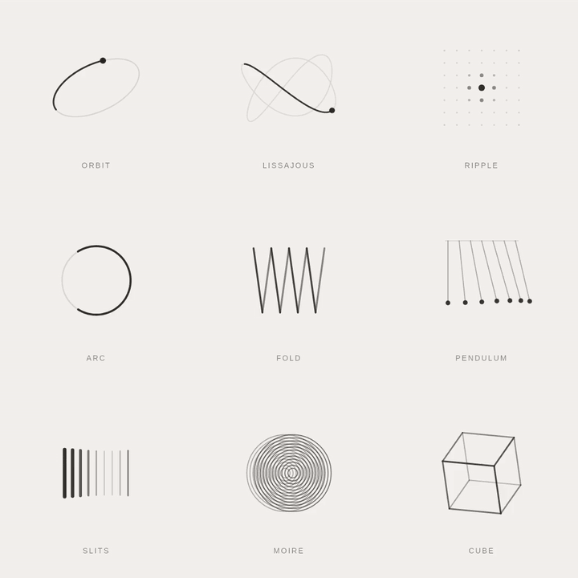

# Nine looping loaders

[Back to the showcase](../../README.md#showcase) · [Watch the original video](https://github.com/lbframe/animation-studio/releases/download/v0.1.0/nine-loaders.mp4)



Nine quiet geometric studies share a warm off-white background, charcoal lines, generous spacing, and a four-second cycle. This was the initial motion study that informed Animation Studio, created before the workflow was packaged as the `create-animation` skill.

## Showcase render

| Input | Output | Method |
| --- | --- | --- |
| A linked animation reference and a request for research and practical evaluation | 4 seconds · 1080 × 1080 · 60 fps · silent | Deterministic JavaScript geometry, shared SVG/Canvas renderers, and a Canvas-to-FFmpeg export |

The board contains **Orbit, Lissajous, Ripple, Arc, Fold, Pendulum, Slits, Moire, and Cube**. Periodic functions and phase offsets control their movement. The source separates scene geometry from rendering, so SVG and Canvas draw the same motion model.

These are original studies inspired by families of geometric motion, not claimed frame-for-frame recreations of the linked reference. The README GIF is a preview export of the existing video; the original nine-loader animation is preserved.

## Original request — English translation

> How can I create this quality of animation with AI?

The request linked to [this animation reference](https://x.com/RaminNasibov/status/2118030565320364523).

The follow-up asked for research and hands-on evaluation:

> Before answering, find the best experts on the subject, identify their techniques, and answer as they would. You can run your own tests and evaluations, then tell me which solution you would choose.

The nine motifs, restrained visual treatment, four-second cycle, and output settings were production choices developed during that exploration; they were not specified in the original request.

## Recommended prompt

To use this study as a reference, attach the nine-loader grid and paste:

```text
Use $create-animation to recreate the attached nine-loader board as
editable procedural motion.

Preserve its 3×3 arrangement: Orbit, Lissajous, Ripple, Arc, Fold,
Pendulum, Slits, Moire, and Cube. Keep the warm off-white background,
fine charcoal strokes, muted tracks, small uppercase labels, and
generous spacing. Keep the camera fixed and the animation silent.

Give each motif its own motion character while sharing a four-second
cycle. Preserve the geometry and framing throughout. Make the loop
continuous in position and velocity, with no jump or duplicate ending.
Use deterministic time-based motion and keep timing, stroke width,
color, and amplitude editable.

Deliver a 1080 × 1080 MP4 at 60 fps, a compact looping GIF, and editable
JavaScript source. Inspect the rendered shapes, thin lines, labels,
and loop transition. Pair numeric continuity checks with visual
inspection, correct defects, and report what was actually verified.
```

This prompt is a later adaptation of the delivered board. It was not used to generate the original study and has not been rerun to certify an identical result.

## Source and review notes

The original study includes `scene.js`, SVG and Canvas renderers, an interactive player, dependency versions, offline checks, and rendered evidence. Its motion model was also exercised with deterministic GSAP seeking; the video itself is an offline Canvas render.

The recorded checks cover periodic geometry, finite values, tile bounds, stable primitive structure, repeated raster output at the same phase, and 240 distinct export frames over one cycle without a duplicate terminal frame. These checks do not establish browser playback performance or an observed browser frame rate. The original encoded video remains 60 fps.

The original source project is retained with the earlier study. This local review package presents its existing animation alongside the later showcase examples.
