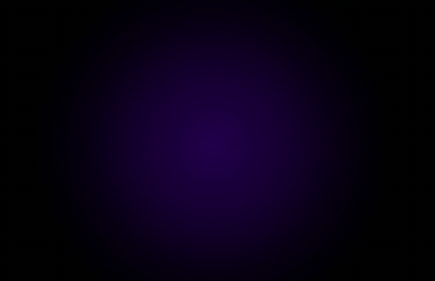

# A logo reveal

[Back to the showcase](../../README.md#showcase) · [Watch the original video](https://github.com/lbframe/animation-studio/releases/download/v0.1.0/ribbon-a.mp4)



A short construction sequence that reveals the strokes, introduces the main letter, and settles on the supplied logo.

## Showcase render

| Input | Output | Method |
| --- | --- | --- |
| Supplied A-logo image | 5 seconds · 1084 × 700 · 30 fps · silent | Canvas compositing with an editable JavaScript timeline; FFmpeg video export |

The three diagonal strokes appear in sequence, followed by the cyan-to-magenta A and a restrained light pass. A stable ending preserves the original composition. The reference is 542 × 350 pixels; the larger video dimensions do not add source-image detail.

## Original request — English translation

> Using this reference image, can you create the animation?

The request included the logo image. No further correction was recorded for this example.

## Recommended prompt

Attach the logo reference, then paste:

```text
Use $create-animation to animate the attached A-logo reference.

Create a five-second reveal: introduce the three diagonal strokes in
sequence, reveal the main A, add a restrained light pass, and settle into
a clear final hold. Preserve the logo's silhouette, cyan, magenta and
violet palette, black background, and original composition. Keep the
camera fixed and the animation silent.

Deliver editable source, a playable preview, and an MP4 at 1084 × 700,
30 fps. Inspect the reveal and final hold, correct masking artifacts,
and keep the finished logo faithful to the reference.
```

The duration, sequence, and output settings above are recommendations based on this delivered example. They were production choices, not additional wording in the original request.

## Source and review notes

The original project contains `logo.js`, `render.cjs`, `build-html.py`, a motion brief, and a standalone HTML preview with the reference image embedded. The logo is composited from the supplied artwork, with editable timing and masks.

The showcased render was created from the original request before this recommended prompt was written. The prompt is a reusable adaptation; it has not been rerun to certify an identical result.
